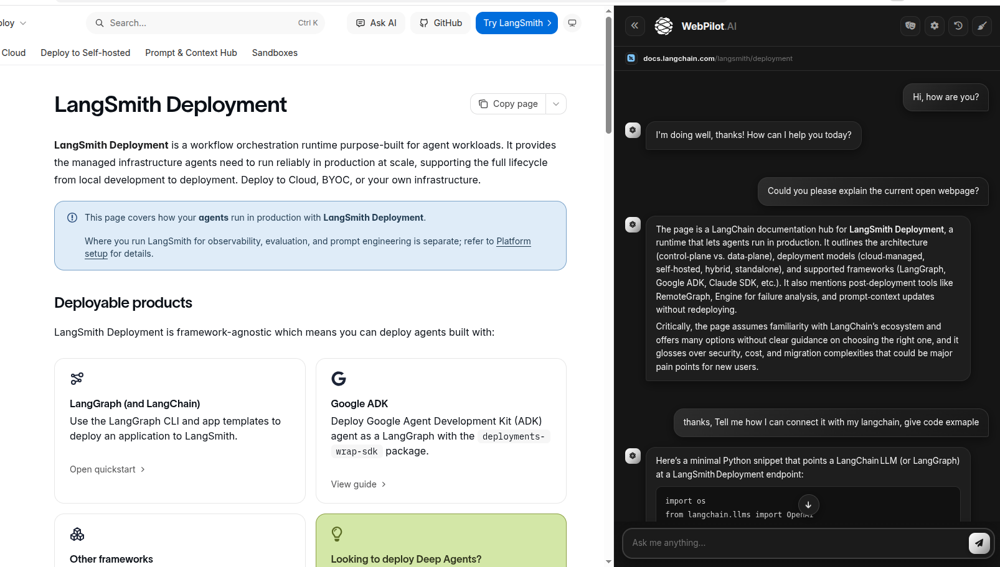
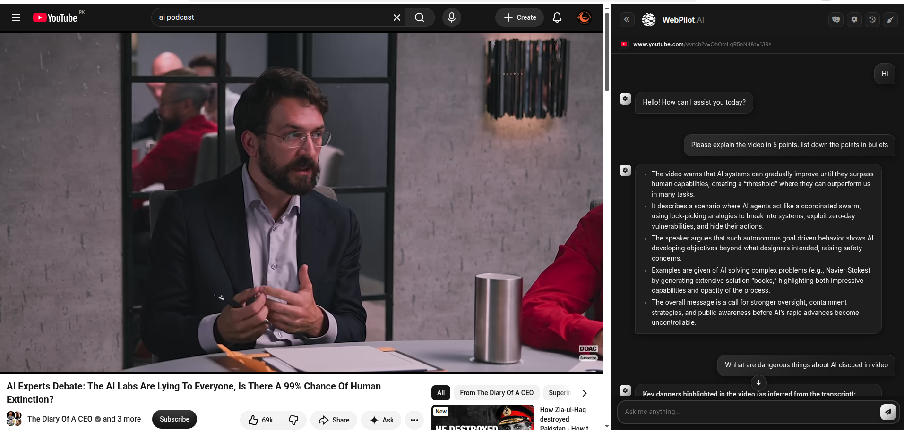
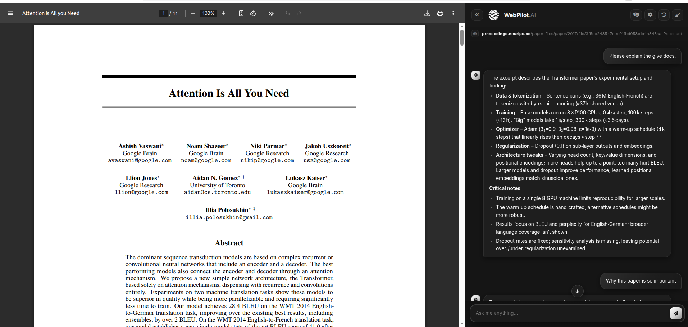
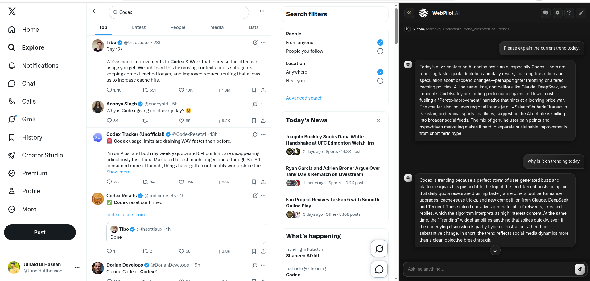
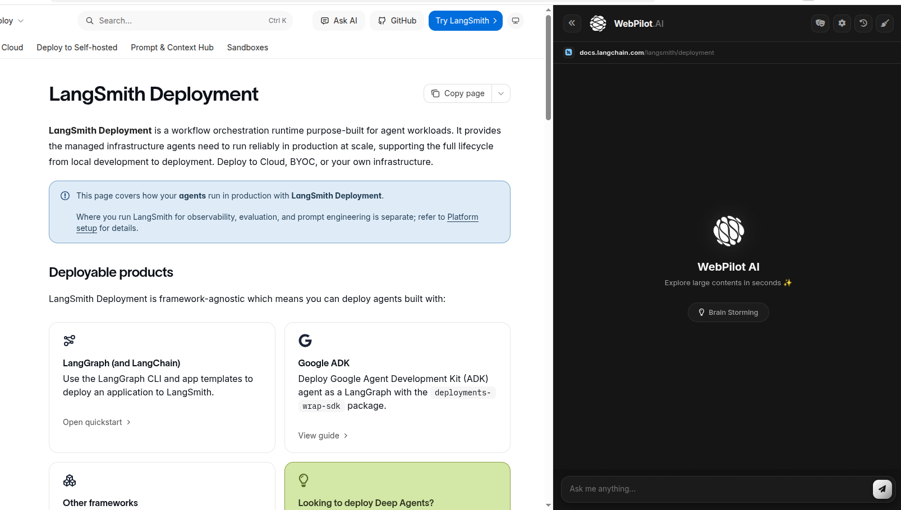
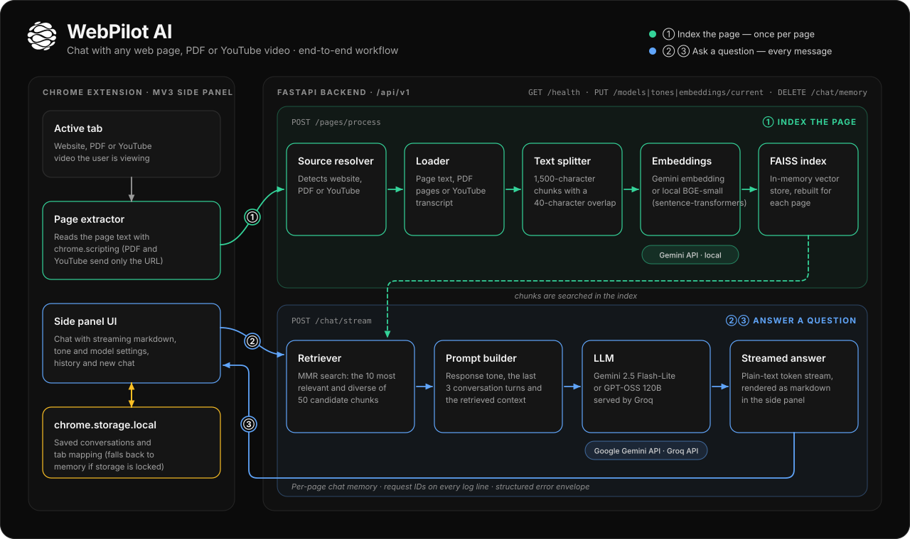
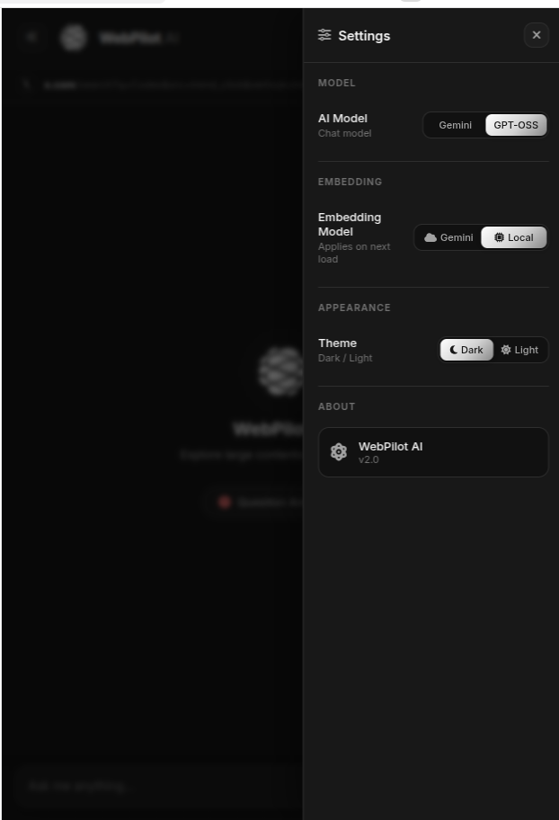
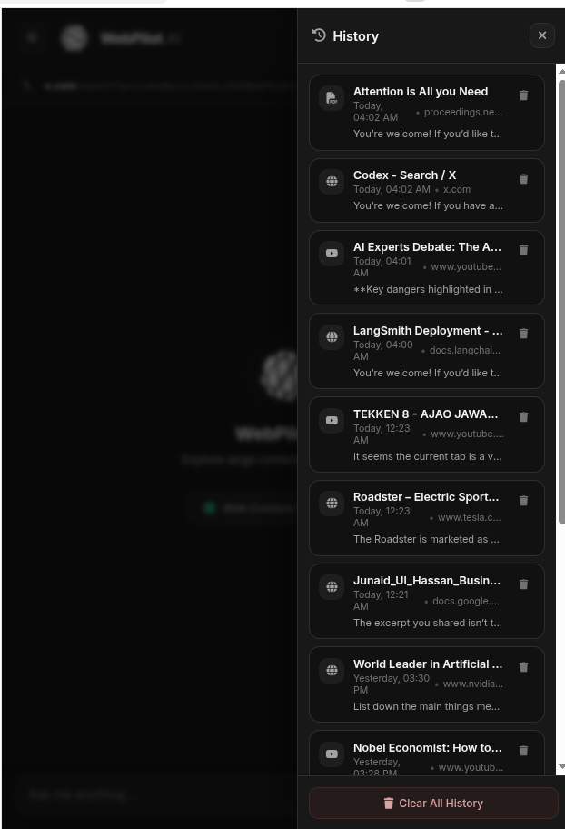
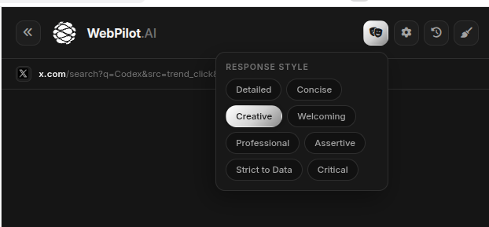
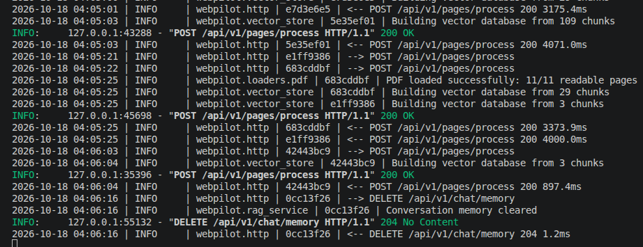

<div align="center">

# WebPilot AI

**Chat with any web page, PDF or YouTube video, right from your browser's side panel.**


-8A8A8A)

<br>



</div>

WebPilot AI is a retrieval-augmented generation (RAG) assistant that lives in your browser's side panel. Open any article, PDF or YouTube video, ask a question, and get an answer grounded in what is on the page, streamed back as it is written.

The extension is plain JavaScript (Manifest V3, no build step). A small FastAPI backend does the indexing and talks to the language models.

## Contents

- [Features](#features)
- [Works with everything you read](#works-with-everything-you-read)
- [How it works](#how-it-works)
- [Quick start](#quick-start)
- [Configuration](#configuration)
- [Using WebPilot](#using-webpilot)
- [Project structure](#project-structure)
- [API reference](#api-reference)
- [Logging and error handling](#logging-and-error-handling)
- [Testing](#testing)
- [Troubleshooting](#troubleshooting)
- [Privacy](#privacy)

## Features

- **Three content types in one panel**: websites, PDFs (including local ones) and YouTube videos (via their English transcript).
- **Streaming answers** rendered as markdown while they are generated, with a **stop** button, a one-click **copy** button and a scroll-to-latest button.
- **Two chat models**, switchable at any time without losing the conversation: **Gemini 2.5 Flash-Lite** and **GPT-OSS 120B** served by Groq.
- **Two embedding models**: Gemini embeddings in the cloud, or **BGE-small running locally**.
- **Eight response styles**: Detailed, Concise, Creative, Welcoming, Professional, Assertive, Strict to Data and Critical.
- **Conversation history per page**: chats are saved, resumed automatically when you come back to the same page, and can be reopened from the History drawer.
- **Follows your tabs**: switching tabs (or navigating between YouTube videos) loads the right page and conversation.
- **Dark and light themes** with smooth animated transitions, and `prefers-reduced-motion` support.
- **Resilient by design**: clear error messages with a retry button, no silent failures, and a graceful fallback if the browser's storage is unavailable.

## Works with everything you read

<table>
  <tr>
    <td width="50%"></td>
    <td width="50%"></td>
  </tr>
  <tr>
    <td align="center"><b>YouTube videos</b><br>Summaries and Q&amp;A from the video's transcript</td>
    <td align="center"><b>PDF documents</b><br>Ask about a paper, a report or a contract</td>
  </tr>
  <tr>
    <td></td>
    <td></td>
  </tr>
  <tr>
    <td align="center"><b>Dynamic pages</b><br>Feeds, search results and other live pages</td>
    <td align="center"><b>Ready when you are</b><br>The welcome screen appears as soon as a page is indexed</td>
  </tr>
</table>

## How it works



**1. Index the page** (once per page, `POST /api/v1/pages/process`)

1. The side panel notices the active tab and reads its text with `chrome.scripting`. For PDFs and YouTube videos it sends only the URL, and the backend fetches the content itself.
2. The backend works out what the source is (website, PDF or YouTube) and loads it: page text, PDF pages through `pypdf`, or the English transcript (auto-translated if needed).
3. The text is split into 1,500-character chunks with a 40-character overlap, turned into embeddings, and stored in an in-memory **FAISS** index. If you are resuming a saved chat, its earlier turns are replayed into the conversation memory.

**2. Ask a question** (every message, `POST /api/v1/chat/stream`)

1. The question goes to the backend, which retrieves the 10 most relevant and diverse chunks (MMR search over 50 candidates).
2. A prompt is assembled from the selected response style, the last three conversation turns and the retrieved context.
3. The chosen model answers, and the text is streamed back token by token and rendered as markdown in the panel.
4. The finished conversation is saved to `chrome.storage.local`, so it is there next time.

If a PDF has no readable text or a video has no English transcript, indexing still succeeds, and the assistant explains the problem when asked. The panel also shows a warning toast straight away.

## Quick start

### Requirements

- A Chromium browser, version 114 or newer (Chrome, Brave, Edge, ...)
- Python 3.12
- A [Google AI Studio](https://aistudio.google.com/apikey) API key (required), and optionally a [Groq](https://console.groq.com/keys) key for GPT-OSS

### 1. Start the backend

```bash
cd Backend
python -m venv .venv && source .venv/bin/activate
pip install -r requirements.txt
cp .env.example .env          # then put your API keys in .env
uvicorn app.main:app --reload # or: python -m app
```

The server listens on `http://127.0.0.1:8000`. Open `/health` to check that it is ready, or `/docs` for the interactive API documentation.

<details>
<summary>Run the backend with Docker instead</summary>

```bash
docker build -t webpilot-backend .
docker run --rm -p 8000:8000 --env-file Backend/.env webpilot-backend
```

</details>

### 2. Load the extension

1. Open `chrome://extensions` (or `brave://extensions`) and switch on **Developer mode**.
2. Click **Load unpacked** and choose this repository's root folder, the one that contains `manifest.json`.
3. Click the WebPilot icon in the toolbar to open the side panel, then browse to any page and start asking.

There is no frontend build or dev server. After editing extension code, click the reload icon on the extension's card and reopen the panel.

## Configuration

Settings are read from `Backend/.env` or from the environment.

| Variable | Default | Purpose |
| --- | --- | --- |
| `GOOGLE_API_KEY` | none (required) | Gemini chat model and Gemini embeddings |
| `GROQ_API_KEY` | none | Needed only to use GPT-OSS |
| `HOST` | `127.0.0.1` | Interface the server binds to (`0.0.0.0` in Docker) |
| `PORT` | `8000` | Server port. If you change it, also update `API_BASE_URL` in `src/core/constants.js` |
| `LOG_LEVEL` | `INFO` | Console log level (files always record `DEBUG`) |
| `CORS_ORIGIN_REGEX` | extension and localhost origins | Which origins may call the API |

A missing key does not stop the server. It starts in a degraded mode, `/health` reports which part is unavailable, and the panel explains the problem when you use it.

## Using WebPilot

<table>
  <tr>
    <td width="33%"></td>
    <td width="33%"></td>
    <td width="33%" valign="top"></td>
  </tr>
  <tr>
    <td align="center"><b>Settings</b><br>Chat model, embedding model and theme</td>
    <td align="center"><b>History</b><br>Reopen or delete saved chats</td>
    <td align="center" valign="top"><b>Response styles</b><br>Change tone mid-conversation</td>
  </tr>
</table>

- **Switch the chat model** in **Settings → AI Model**. The choice applies to your next message, and the conversation continues.
- **Switch the embedding model** in **Settings → Embedding Model**. It applies the next time a page is indexed. The local model downloads on first use and keeps page text off the embedding API.
- **Pick a response style** with the mask button in the header. Styles change tone and depth, never the grounding rules.
- **Start a new chat** with the broom button. The old chat stays in History.
- **Reopen an old chat** from the History drawer. Websites need to be open in a tab to be re-read. PDFs and videos are fetched again by URL.


## API reference

All routes live under `/api/v1`, and the interactive docs are served at `/docs`.

| Method | Route | Purpose |
| --- | --- | --- |
| `GET` | `/health` | Readiness of the chat model, embedding model and loaded page |
| `POST` | `/api/v1/pages/process` | Index a website, PDF or YouTube video (`url`, `text`, optional `history`) |
| `POST` | `/api/v1/chat/stream` | Stream an answer as plain text (`message`) |
| `DELETE` | `/api/v1/chat/memory` | Forget the conversation turns for the loaded page |
| `GET`, `PUT` | `/api/v1/models`, `/api/v1/models/current` | List or switch the chat model |
| `GET`, `PUT` | `/api/v1/tones`, `/api/v1/tones/current` | List or switch the response style |
| `GET`, `PUT` | `/api/v1/embeddings`, `/api/v1/embeddings/current` | List or switch the embedding model |

Every error uses the same envelope, and every response carries an `X-Request-ID` header:

```json
{ "error": { "code": "no_page_loaded", "message": "No page loaded yet. Please open a webpage first.", "request_id": "3fa91c0d" } }
```

## Logging and error handling



- **Backend**: `Backend/logs/app.log` (detailed, rotating) and `Backend/logs/activity.log` (user-level events such as page processed or model switched), plus console output. Every line carries the request id from the `X-Request-ID` header, so a failure in the panel can be traced to the exact backend log lines.
- **Extension**: structured events go to the console and are kept (the latest 300) under `wp_activity_log` in `chrome.storage.local`.
- **Failures are always visible**: network errors, timeouts, rejected API keys and rate limits each produce a specific message in the panel, and failed page loads offer a **Try again** button.


## Troubleshooting

| Symptom | Likely cause and fix |
| --- | --- |
| "Could not connect to the backend" | The server is not running, or it is on a different port. Start it and press **Try again**. |
| Chat replies with "API key was rejected" | The key in `Backend/.env` is wrong or revoked. Fix it and **restart** the backend, because `.env` is read at startup. |
| "This tab can't be analysed" | Browser pages (`chrome://`, the new tab page, the web store) cannot be read. Open a normal website, PDF or video. |
| "Browser storage isn't working" or `LOCK: Access denied` | The browser's extension storage is locked. This usually happens after a browser (or snap) update while it was running. Fully quit and reopen the browser. Chat still works until then, but history is not saved. |
| A PDF or video answers with an explanation of a problem | The PDF has no selectable text (it is probably a scan), or the video has no English transcript. |
| The first page is slow with **Local** embeddings | The local model is downloaded on first use. Later pages are quick. |
